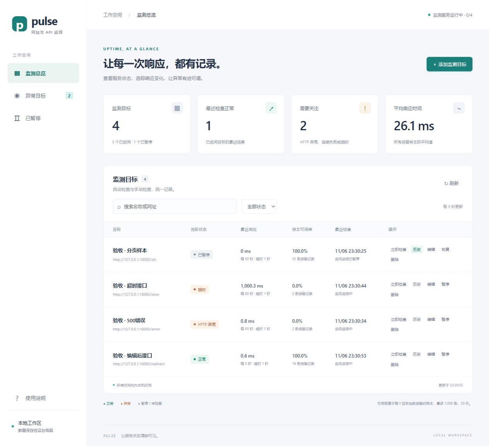
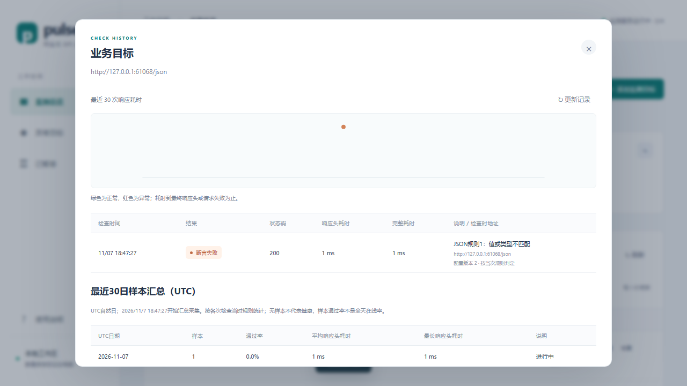

# Pulse · Go 网站/API 可用性监测

[](https://github.com/XiuGuang-Alter/pulse-go-monitor/actions/workflows/ci.yml)

一个本机运行的 Go 监测工具：定时访问多个 HTTP/HTTPS 目标，把状态、耗时和历史保存到 SQLite，再通过内嵌网页查看。运行不需要 Node 或外置数据库。

v1.2在原有监测功能上增加：

- 监测器自身健康与结果新鲜度，区分工具退化、目标失败和旧结果。
- URL敏感参数安全展示、结构化错误分类与表单字段/规则定位；实际请求保持原始配置。
- 独立备份/校验、新路径恢复、配置预检与导入导出、UTC范围历史导出，以及实际保留范围说明。

启动时将数据库升级至schema4，v1.1不能直接打开升级后的库。先停止服务、保全并校验升级前备份；回退使用旧程序和恢复到新路径的旧schema备份。操作见[数据维护](docs/数据维护.md)。已完成[24小时实跑](docs/performance/v1.2/soak/README.md)、[完整同机性能复核](docs/performance/v1.2/full/README.md)、三浏览器及独立审查；历史接口约1ms新增成本及调查结果如实披露。最终提交、制品和发布后复验按[验收证据](docs/verification/v1.2/acceptance.md)及对应Release记录核对。



## 快速开始

Windows用户从 [Releases](https://github.com/XiuGuang-Alter/pulse-go-monitor/releases) 下载 `pulse-v1.2.0-windows-amd64.zip`，解压到可写目录，双击 `启动演示.cmd`，打开 http://127.0.0.1:8080 。正常、500及超时演示接口在8091端口；关闭终端前优先按Ctrl+C正常退出。

使用自己的目标双击 `启动监测.cmd`。默认数据库 `data/monitor.db`；演示脚本单独使用 `data/demo.db`。数据位于启动工作目录，启动脚本会先进入程序目录。下载校验及运行说明见 [下载包使用说明](docs/下载包使用说明.md)。

```powershell
.\go-monitor.exe serve
.\go-monitor.exe serve -addr 127.0.0.1:8082 -concurrency 4
.\go-monitor.exe serve -demo -demo-addr 127.0.0.1:8092 -db data/demo.db
.\go-monitor.exe 'https://example.com'
```

## 升级与回退

先停止旧程序，用v1.2的独立维护命令对升级前数据库备份并校验，再启动新版。数据库1/2/3会在同一事务升级至4，目标与历史ID保留。**旧程序不能直接打开schema4**；回退时停止新版，把升级前备份恢复到新路径，再用对应旧版打开。不要运行中只复制 `.db` 而遗漏 WAL 文件。

日汇总只会回填仍保留的旧明细，标记“迁移前历史不完整”；已淘汰的记录无法恢复。详细步骤见 [下载包使用说明](docs/下载包使用说明.md)。

## 功能与约定

- 最多100个目标，可新增、编辑、暂停/恢复、删除和立即检查。
- 全局并发1–32（默认4），同目标不重叠；手动请求饱和时409，不无限排队。
- 完成检查及更新配置时合并唤醒调度，250毫秒轮询兜底；存储失败至少退避1秒。
- 间隔5–86400秒、超时1–30秒。完成检查后加间隔；不补跑停机周期，不保证整点触发。
- 暂停不取消在途请求，暂停目标可手动检查。编辑有版本保护；旧任务按检查时URL归档，不回滚新配置。
- 每目标最多1000条且最多30天；历史按ID游标分页。可用率及平均耗时只基于保留样本。
- 网页搜索、筛选、历史、趋势图及手机视口布局，每5秒刷新；删除级联清理历史。
- 默认200–299通过，跟随重定向；可选允许状态码、正文包含及JSON Pointer标量相等规则，所有规则须同时满足。正文按解压后1MiB限制读取；未配置正文规则时不等待正文。
- 原响应耗时到最终响应头或请求失败；新增完整耗时包含正文和断言。旧历史没有完整耗时和配置版本，显示为空。CLI默认行为及退出码保持：0通过、1检查失败、2参数错误。
- 独立查看最近30个UTC自然日汇总；无样本不补成功率，当天标记进行中。汇总按当次规则判定，跨规则时期不能直接等价比较。



## 从源码运行与验证

安装 `go.mod` 指定的Go版本：

```powershell
go test ./... -count=1
go vet ./...
go build -trimpath -o go-monitor.exe .
```

Windows可用 `go.ps1` 包装Go命令，优先选择项目本地工具链，否则使用PATH中的Go；它仅设置当前进程缓存，不修改系统PATH。源码仓库不附带工具链。

开发测试使用Node24，依赖已锁定：

```powershell
npm.cmd ci --ignore-scripts
npm.cmd test
npx.cmd playwright install chromium firefox
npm.cmd run test:e2e
.\scripts\test-page-acceptance.ps1
```

Linux使用不带.cmd后缀的npm/npx。CI在Windows和Ubuntu执行检查；Ubuntu启用CGO运行 `go test -race ./...`。真实进程测试在Windows使用独立隐藏控制台Ctrl+C，在Unix使用SIGINT；不会向用户共享控制台发送信号。详见 [测试说明](docs/测试与验证.md) 和 [性能实验](docs/performance/README.md)。

## API

| 方法 | 路径 | 用途 |
| --- | --- | --- |
| GET | `/api/status` | 服务状态和并发占用 |
| GET / POST | `/api/targets` | 列表 / 创建 |
| PUT / DELETE | `/api/targets/{id}` | 完整替换配置 / 删除与历史级联 |
| POST | `/api/targets/{id}/check` | 异步触发202，饱和409 |
| GET | `/api/targets/{id}/checks?limit=50&before_id=123` | 历史分页 |
| GET | `/api/targets/{id}/daily?days=30` | 最近1–30个UTC日期桶 |

创建/更新使用 `application/json`，正文最多16384字节，拒绝未知字段：

```json
{"name":"我的接口","url":"https://example.com","interval_seconds":60,"timeout_seconds":5,"enabled":true}
```

时间为Unix毫秒，耗时为毫秒；历史返回 `items` 与 `next_before_id`，limit范围1–200。下一页将上一页的 `next_before_id` 作为 `before_id`；为空时没有更多记录。

状态接口新增 `monitor_health`；目标列表新增配置版本及 `freshness`。配置API仍含原始 `url`，`display_url` 用于安全展示；历史分类统计仅覆盖当前保留明细，不能当作完整30日错误分布。详细字段语义见[架构说明](docs/架构.md)。

可选 `rules` 示例：`{"expected_statuses":[200],"body_contains":"code","json_equals":[{"pointer":"/code","equals":0}]}`。POST缺省使用默认规则，PUT缺省保留已有规则，显式 `null` 重置。状态码最多10个（200–599），正文包含文本、Pointer和期望字符串各最多256个UTF-8字节；JSON断言最多5条，期望值限标量。支持RFC6901转义，缺失与null不同，不做类型转换，数字精确比较。详细解析预算见 [架构](docs/架构.md)。

## 架构与资料

`main/serve → server（API和内嵌页面）→ store（SQLite）/ scheduler（有界调度）→ Check（HTTP）`。

SQLite使用纯Go驱动，开启外键、WAL和busy_timeout，单连接，网络请求在事务外。网页通过go:embed嵌入，修改前端也需重新构建。

- [架构与取舍](docs/架构.md)
- [测试与验证](docs/测试与验证.md)
- [性能实验与原始数据](docs/performance/README.md)
- [版本记录](CHANGELOG.md)
- [v1.2验收证据与验证边界](docs/verification/v1.2/acceptance.md)

项目由AI协助实现并经过实际验证。性能数据的环境、原始记录和适用边界见性能报告。

## 使用边界

仅绑定回环地址，供本机个人使用；没有账号、邮件通知、多租户或集群。Host/Origin校验不是完整鉴权。允许检查内网/本机地址，未提供SSRF隔离，请勿反向代理到公网。URL原始配置会存库；指定参数在展示中脱敏，但配置API、编辑界面、数据库、完整配置和备份仍可能含原始敏感信息，且不会识别任意名称、路径或规则值中的秘密。不要将它们公开上传。

业务断言只验证配置的响应条件，不能证明完整登录、支付流程正常；不会自动修复故障。样本可用率不是完整24小时SLA。Go读取HTTP_PROXY、HTTPS_PROXY、NO_PROXY环境变量，证书验证保持开启，不自动读取Windows设置的代理。

备份前停止服务再复制data目录；运行中不要只复制.db而遗漏WAL日志。用户数据、工具链、缓存和临时验收记录均不进入源码仓库或下载包。

MIT协议，见 [LICENSE](LICENSE)。


## 数据维护

运行 `go-monitor.exe maintain help`：完整备份与验证、新路径恢复、配置导出/预检/新库导入，以及按UTC范围导出JSON/CSV历史。导入默认暂停目标，已有文件不覆盖；读取源库不迁移或清理。页面历史展示实际保留范围与理论覆盖时长。详见[数据维护](docs/数据维护.md)。
