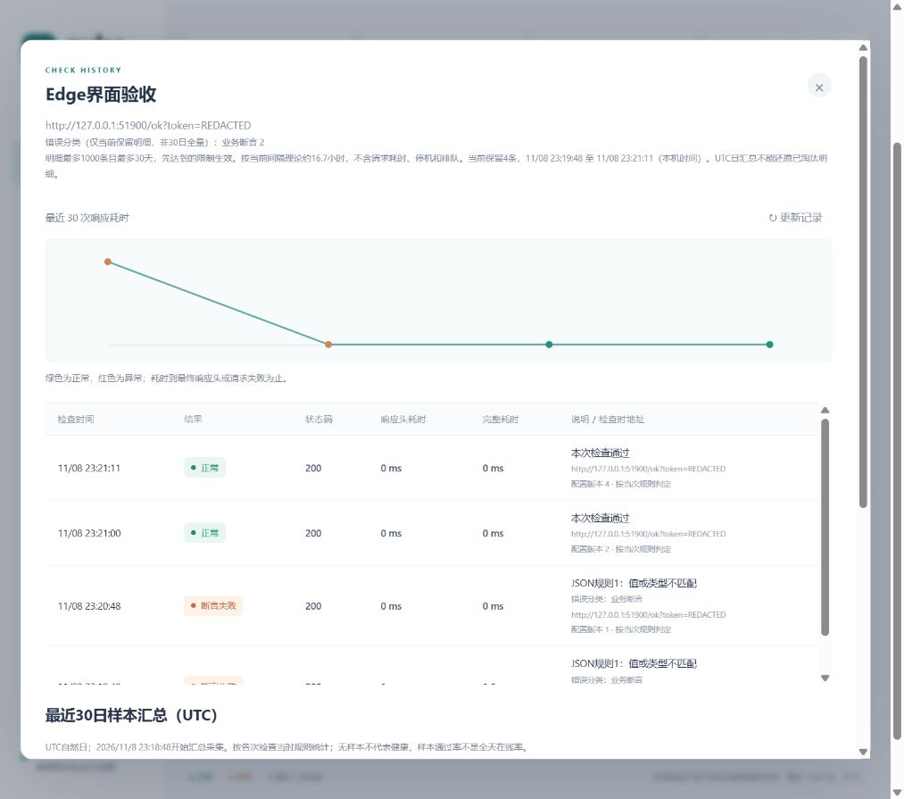

# Edge实际界面交互验收

2026-11-08，本机Edge156.0.4314.58。通过已连接的Edge浏览器通道新建实际页面，使用可见控件逐步操作，并检查AX/DOM与截图；不是复跑无界面Playwright脚本，也不声称真人或物理设备验证。仅使用独立回环演示服务、临时SQLite与虚构token，未操作用户数据库。

| 操作 | 实际观察 |
| --- | --- |
| 总览 | 正常、HTTP500和超时三类演示目标显示，监测器自身正常 |
| 无效规则 | bad-pointer被定位到JSON规则1，名称、网址和期望值输入保留 |
| 创建有效规则 | /message与错误期望值保存后显示断言失败，列表token为REDACTED |
| 历史 | HTTP200但业务失败、规则编号、分类、实际保留范围与UTC汇总清楚 |
| 编辑修正 | 编辑中保留原始虚构token；将期望值改为演示上游实际值后，最新检查恢复正常 |
| 暂停/恢复 | 先明确显示已暂停，恢复后重新采样且地址仍脱敏 |
| 页面刷新 | 新旧规则版本历史均保留，最新正常与旧断言失败分别展示 |
| 维护指引 | 备份、校验、新路径恢复、完整配置导出、预检及默认暂停说明可见 |

先前原生窗口读取因无法可靠识别当前浏览器URL被工具中止，那次未记通过。本次在后续会话中发现可用的Edge浏览器通道，明确本机URL后重新完成；未修改安全设置或越过浏览器警告。中途一次AX节点因5秒自动刷新失效，重新读取页面状态后改用可见目标行的语义定位继续，未修改产品。

验收程序对应[browser-results.json](../../performance/v1.2/browser-results.json)中的产品源码及测试二进制指纹。完成后按PID、路径及启动时间核对并停止本次测试服务；截图与自动化证据分开保留。
